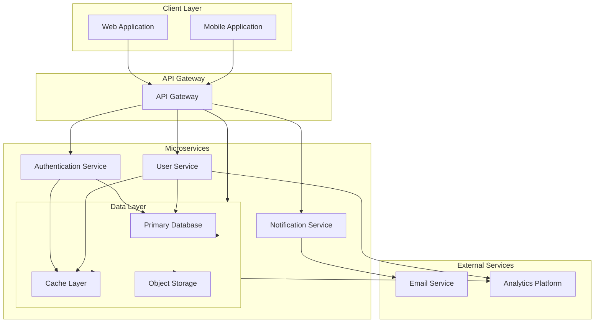

# Architecture Overview

This document provides a visual overview of the system architecture.

## System Architecture Diagram

## Architecture Components

### Client Layer
- **Web Application**: Single Page Application (SPA) for web users
- **Mobile Application**: Native mobile application for iOS and Android

### API Gateway
- Central entry point for all client requests
- Handles request routing and load balancing
- Implements rate limiting and request validation

### Microservices
- **Authentication Service**: Handles user authentication and authorization
- **User Service**: Manages user profiles and account information
- **Data Service**: Handles core business logic and data operations
- **Notification Service**: Manages notifications across multiple channels

### Data Layer
- **Primary Database**: Main persistent data storage
- **Cache Layer**: In-memory caching for performance optimization
- **Object Storage**: Cloud storage for files and media

### External Services
- **Email Service**: Third-party email delivery service
- **Analytics Platform**: User behavior and usage analytics

## Communication Flow

1. Clients send requests to the API Gateway
2. API Gateway routes requests to appropriate microservices
3. Services interact with the data layer (database, cache, storage)
4. Services communicate with external services as needed
5. Responses are sent back through the API Gateway to clients
